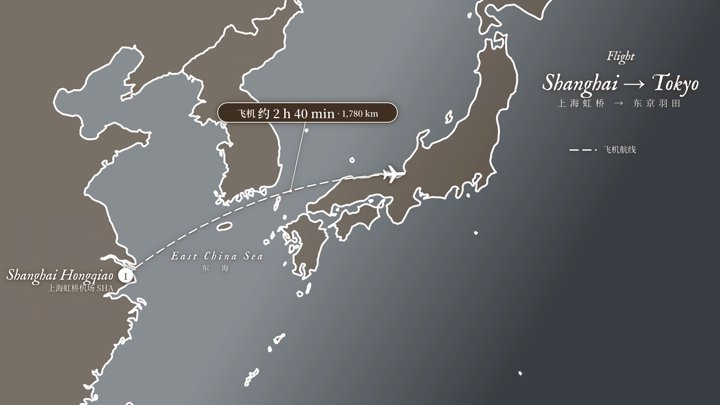
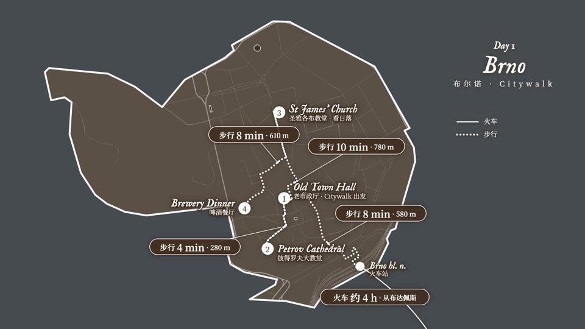

# travel-route-map · 旅行路线地图透明动画 Skill

把旅行行程一键做成**复古地图风的透明通道路线动画**（ProRes 4444 带 alpha 的 MOV），直接叠在 vlog 画面上。

- 真实地理轮廓做底（国家 / 州 / 城区），不是挡画面的矩形框
- 白色虚线路线逐段画出，**每段标注交通方式 + 时长 + 距离**
- 航线图有小飞机沿虚线飞，机头始终朝前
- 城市步行用真实街道底图；老城太挤自动用圆形放大镜
- 任意分辨率输出（1080p、4K、相机原生 4992×3328 都行，矢量放大不糊）
- 可用照片/视频 GPS 核对真实地点和每段用时

| 航线图（小飞机沿虚线飞） | 城市步行（真实街道 + 老城轮廓） |
|---|---|
|  |  |

适用于 Claude Code（Agent Skills）。装好后对 Claude 说「把这段行程做成透明通道路线地图」「做一个上海飞东京的航线图」即可。

## 安装

```bash
git clone https://github.com/versense84-cmd/travel-route-map.git ~/.claude/skills/travel-route-map
pip3 install --user mapbox-vector-tile shapely
brew install ffmpeg node        # macOS；另需 Google Chrome
```

## 手动使用

```bash
python3 ~/.claude/skills/travel-route-map/scripts/init.py ~/Downloads/my-trip
cd ~/Downloads/my-trip
cp ~/.claude/skills/travel-route-map/examples/cfg-flight.js .
python3 ~/.claude/skills/travel-route-map/scripts/build.py flight 上海-东京 --still --render
```

城市步行示例见 `examples/cfg-citywalk.js`（文件顶部写了准备数据的 4 条命令）。完整流程和配置字段见 [SKILL.md](SKILL.md)。

## 目录

```
SKILL.md                 Skill 说明（流程、设计规则、配置字段、常见坑）
assets/engine.html       地图引擎（d3 + world-atlas），按 cfg 画出最终 SVG
assets/anim-template.html  HyperFrames + GSAP 动画模板（描边、逐段画线、点弹出、飞机）
scripts/init.py          建项目文件夹
scripts/geo_tiles.py     OpenFreeMap 矢量瓦片 → 街道/水面/公园底图
scripts/bounds.py        Nominatim → 行政边界轮廓
scripts/shapes.py        合并轮廓、去海面、裁剪
scripts/routes.py        OSRM → 真实路线几何 + 距离 + 时长
scripts/build.py         出静态图 / 透明 MOV / 预览
examples/                航线、城市步行两个示例
```

## 数据来源

地图数据 © OpenStreetMap contributors（ODbL），矢量瓦片来自 OpenFreeMap，国界来自 Natural Earth / world-atlas，路线来自 FOSSGIS OSRM。公开发布作品时请注明 OpenStreetMap。

## License

MIT
